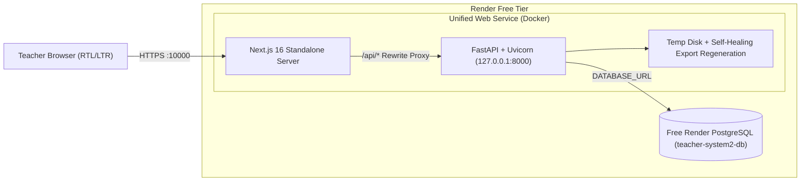

# Go-Live Tomorrow Plan: Render Free Tier + Persistent Free PostgreSQL (`teacher-system2`)

## Goal Description

Deploy **Teacher System (`teacher-system2`)** live on **Render (100% Free Tier)** in **Shared Pilot / Demo Mode**, backed by a **persistent free Render PostgreSQL database (`teacher-system2-db`)** so teacher contexts, chapters, lessons, plans, and audit trails persist across container restarts and future code deployments—and are ready for a future username/password authentication upgrade.

Key architectural & production measures:
1. **Lean `requirements.txt` (12 packages)**: Stripped 75 unused heavy ML/vision packages so Render Free Tier builds stay fast and within the 512 MB RAM ceiling.
2. **Automatic Pilot Seeding on Startup**: `ensure_initial_seed_data(db)` runs inside `on_startup()` when `ENABLE_DEMO_SEED=1`.
3. **Single Unified Docker Web Service**: Packages FastAPI (`127.0.0.1:8000`) + Next.js Standalone (`0.0.0.0:$PORT`) together to eliminate 502 inter-service cold-start timeouts.
4. **Persistent Free Render PostgreSQL (`teacher-system2-db`)**: `render.yaml` provisions a free PostgreSQL database and binds `DATABASE_URL` directly; `database.py` normalizes both `postgres://` and `postgresql://` to `postgresql+psycopg2://` (while keeping SQLite WAL mode for local dev).
5. **Self-Healing Export Downloads & JSON Backup/Restore**: `/api/exports/{export_id}/download` regenerates missing files seamlessly from DB snapshots if the container filesystem resets, alongside `GET /api/system/backup` and `POST /api/system/restore`.

---

## System Architecture Diagram

---

## Implemented Changes Summary
- **`render.yaml`**: Added `databases` (`teacher-system2-db`, `plan: free`) and wired `DATABASE_URL` (`fromDatabase` `connectionString`) to `teacher-system2`.
- **`backend/app/database.py`**: Added `normalize_database_url()` handling both `postgres://` and `postgresql://`, plus `DATA_DIR` + SQLite WAL pragmas for local dev.
- **`backend/app/services/migration_and_backup.py`**: Added `export_database_backup_dict()` & `restore_database_backup_dict(payload)`.
- **`backend/app/main.py`**: Configurable `STORAGE_ROOT`, auto-seed on startup, optional `PILOT_ACCESS_PIN` guard on mutating `/api/*` requests, `/api/system/backup` & `/api/system/restore`, and `_build_export_bytes()` + self-healing `download_exported_file()`.
- **`frontend/next.config.mjs` & `frontend/package.json`**: Enabled `output: "standalone"` and added `@types/node`.
- **`Dockerfile`, `scripts/start_prod.sh`, `.dockerignore`, `docs/DEPLOYMENT.md`**: Multi-stage unified build and deployment instructions.
- **`backend/tests/test_migrations_and_backup.py`**: Added tests for backup/restore roundtrip, `PILOT_ACCESS_PIN`, `normalize_database_url`, and self-healing export downloads after disk reset.

### Batch 5 Additions (Real Arabic PDF + OmniRoute / NVIDIA NIM AI)
- **`requirements.txt` & `Dockerfile`**: Added `pymupdf>=1.25.0,<2.0`.
- **`backend/app/services/pdf_service.py`**: Real Arabic/bilingual PDF extraction via PyMuPDF + `NFKC` normalization + `render_pdf_page_to_png_bytes()`.
- **`backend/app/services/ai_service.py`**: Fast NVIDIA NIM / OmniRoute client (`nv-nemotron-3-5-bolt-e4b` for slides/plans/structure, `nv-nemotron-3-5-super-vl-120b` & `nv-nemotron-3-nano-omni-30b` for Vision OCR) with `OMNIROUTE_BASE_URL` and `NVIDIA_API_KEYS` support plus deterministic offline fallback.
- **`backend/app/main.py` & `schemas.py`**: Added `/api/ai/status`, `/api/plans/{id}/ai-generate-slides`, `/api/plans/{id}/ai-generate-plan`, `/api/sources/{id}/pages/{page_id}/ai-ocr`, and `/api/sources/{id}/ai-extract-structure`.
- **Frontend**: Updated `presentations/page.tsx`, `sources/page.tsx`, and `daily-plan/page.tsx`.
- **Tests**: Added `backend/tests/test_ai_and_pdf.py` (21/21 pytest total passing).
