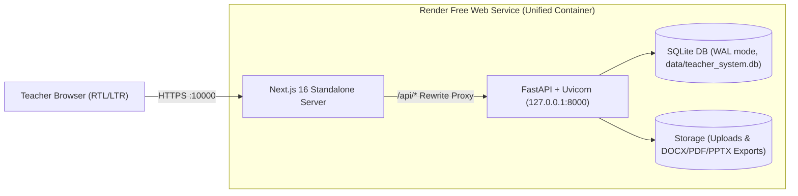

# Go-Live Tomorrow Plan: Render Free Tier Deployment (`teacher-system2`)

## Goal Description

Prepare and deploy **Teacher System (`teacher-system2`)** to go live tomorrow on **Render (100% Free Tier)** in **Shared Pilot / Demo Mode** using **SQLite** (with pre-seeded contexts and live JSON backup/restore).

During codebase inspection, we identified **5 production blockers** that would prevent a clean go-live if deployed as-is:
1. **Bloated `requirements.txt` (87 packages / >500 MB)**: Currently includes heavy unused global packages (`opencv-python-headless`, `scipy`, `scikit-image`, `numpy`, `psd-tools`, `google-genai`, `pytesseract`) that are never imported in `backend/` and cause Render Free Tier builds (512 MB RAM limit) to run out of memory or time out.
2. **Pre-Seeded Contexts Never Trigger on Startup**: `ensure_initial_seed_data` is imported in [main.py](../backend/app/main.py#L66) but never called inside `on_startup()`, so even when `ENABLE_DEMO_SEED=1` is set, the database starts empty.
3. **Render Free Tier Double Cold-Start Timeout**: Deploying Next.js and FastAPI as two separate Render Free services causes Next.js's `/api/*` rewrite proxy to time out (502 Bad Gateway) while waiting ~45 seconds for the second free service to wake up. Packaging both into a **single unified Docker Web Service on Render** eliminates inter-service cold-start timeouts, gives 0ms localhost API calls, and provides a single URL to share tomorrow.
4. **Hardcoded Storage & SQLite Paths**: [database.py](../backend/app/database.py) and [main.py](../backend/app/main.py) need configurable storage/DB paths (`DATA_DIR` / `STORAGE_ROOT`) plus `postgres://` URL normalization in case you ever attach a cloud database later.
5. **Ephemeral Disk Protection on Render Free Tier**: Because Render blocks paid persistent disks on `plan: free`, local SQLite files live on the container's disk and reset only if Render recycles/redeploys the container. To protect teacher work during tomorrow's live pilot, we will wire `ENABLE_DEMO_SEED=1` on startup **and** expose 1-click JSON database backup/restore API endpoints (`/api/system/backup` & `/api/system/restore`) powered by the existing [migration_and_backup.py](../backend/app/services/migration_and_backup.py).

---

## User Review Required

> [!IMPORTANT]
> **Unified Single-Service Architecture for Render Free Tier**
> To keep everything **100% free** and avoid 502 proxy timeouts between two sleeping free services, the deployment uses a single multi-stage `Dockerfile` and `render.yaml` Blueprint. Inside the container:
> - **FastAPI (Uvicorn)** runs internally on `127.0.0.1:8000`
> - **Next.js (`node server.js` standalone)** binds to Render's public `$PORT` (default `10000`) and proxies all `/api/*` requests directly to `http://127.0.0.1:8000/api/*`.

> [!NOTE]
> **SQLite on Render Free Tier + Optional Teacher PIN**
> - With `ENABLE_DEMO_SEED=1`, the live app boots pre-populated with the pilot contexts, templates, lessons, and sample plans.
> - Optional teacher PIN guard: if `PILOT_ACCESS_PIN` is set in Render's environment variables, mutating API actions (`POST`, `PUT`, `PATCH`, `DELETE`) under `/api/*` require the PIN (`X-Pilot-Pin` header or `?pin=`); if left empty (default), anyone with the pilot link can freely test and edit.

---

## System Architecture Diagram

---

## Proposed Changes

### 1. Backend Production Readiness, SQLite Concurrency & Auto-Seed
- `backend/app/database.py`: Support `DATA_DIR`, normalize `postgres://` to `postgresql+psycopg2://`, enable SQLite WAL mode + `synchronous=NORMAL` + `busy_timeout=5000` + `timeout=15`.
- `backend/app/services/migration_and_backup.py`: Add `export_database_backup_dict()` and `restore_database_backup_dict(payload)` while preserving existing DDL and file backup functions.
- `backend/app/main.py`: Make `STORAGE_ROOT` configurable via env, trigger `ensure_initial_seed_data(db)` in `on_startup()`, enforce optional `PILOT_ACCESS_PIN` on mutating `/api/*` routes, and expose `GET /api/system/backup` & `POST /api/system/restore`.

### 2. Frontend Memory Optimization (`frontend/next.config.mjs`)
- Enable `output: "standalone"` to cut Next.js runtime RAM usage within Render Free Tier's 512 MB limit.

### 3. Dependency Slimming (`requirements.txt`)
- Trim unused heavy libraries down to the 12 packages actually used by `backend/`.

### 4. Render Free Tier Container & Blueprint
- Create `.dockerignore`, `scripts/start_prod.sh`, `Dockerfile`, and `render.yaml`.
- Update `docs/DEPLOYMENT.md`.

### 5. Automated Verification & Go-Live Handoff
- Add automated tests for backup/restore and `PILOT_ACCESS_PIN` enforcement.
- Run `pytest backend/tests/ -v` and `cd frontend && npm run build`.
- Record logs in `handoff/EXECUTION_LOG.md` and `handoff/verification_test_output.log`.
